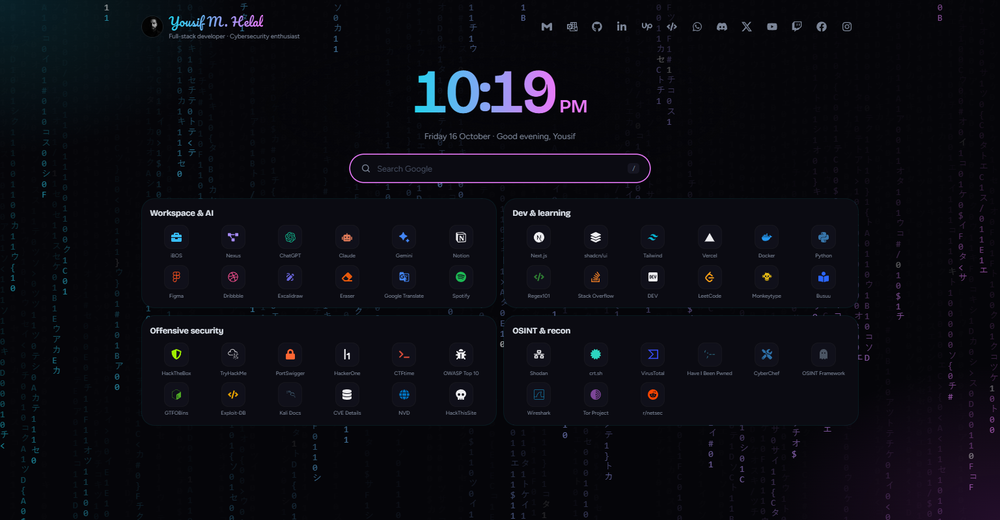

# My Google Home Page

A personal browser start page built with React and Tailwind CSS: a live clock, Google search, and quick links to the tools I use for development and security work, over an animated glyph-rain background.



## Features

- **Clock**: 12-hour time with the date and a greeting, updated every second.
- **Google search**: auto-focused search bar; press `/` anywhere to jump back to it.
- **Quick links**: 45 brand-coloured tiles in four groups: Workspace & AI, Dev & learning, Offensive security, OSINT & recon.
- **Header links**: mail, GitHub, LinkedIn, Upwork, portfolio, chat, and social accounts.
- **Animated background**: falling glyphs on a canvas, shading from cyan to purple. The rain speeds up while you type a search and stays still when the OS "reduce motion" setting is on.

## Tech stack

- React 18 (Create React App / `react-scripts` 5)
- Tailwind CSS 3
- react-icons 4
- gh-pages for deployment

## Getting started

```bash
git clone https://github.com/YousifMHelal/My-google-home-page.git
cd My-google-home-page
npm install
npm start
```

The app runs at `http://localhost:3000`.

## Scripts

| Command | What it does |
|---|---|
| `npm start` | Start the dev server |
| `npm run build` | Build for production into `build/` |
| `npm run deploy` | Build and publish to GitHub Pages |

## Customising

| To change | Edit |
|---|---|
| Links, categories, header icons, name and roles | [src/data/links.js](src/data/links.js) |
| Layout, colours, clock, search bar | [src/App.js](src/App.js) |
| Background animation (speed, colours, glyphs) | [src/components/GlyphRain.js](src/components/GlyphRain.js) |
| Profile photo | `src/profile.jpeg` |
| Fonts | the Google Fonts link in [public/index.html](public/index.html) |

Each link is one line in `links.js`: a label, URL, icon from `react-icons`, and brand colour. Very dark brand colours are lightened automatically so they stay visible on the dark background.

## Project structure

```
src/
├── App.js                   # Page layout: header, clock, search, link tiles
├── index.js                 # React entry point
├── index.css                # Tailwind directives and base styles
├── components/
│   └── GlyphRain.js         # Animated canvas background
├── data/
│   └── links.js             # All links and profile info
├── hooks/
│   ├── useClock.js          # Current time, refreshed on an interval
│   ├── useReducedMotion.js  # Tracks the OS reduce-motion setting
│   └── useSlashFocus.js     # "/" shortcut to focus search
├── utils/
│   ├── brandColor.js        # Lightens brand colours that are too dark
│   └── time.js              # Time, date and greeting formatting
├── profile.jpeg
└── preview.png              # Screenshot used in this README
```

## Deployment

`package.json` sets `homepage` to `https://yousifmhelal.github.io/My-google-home-page`. Run `npm run deploy` to build and push to the `gh-pages` branch.
